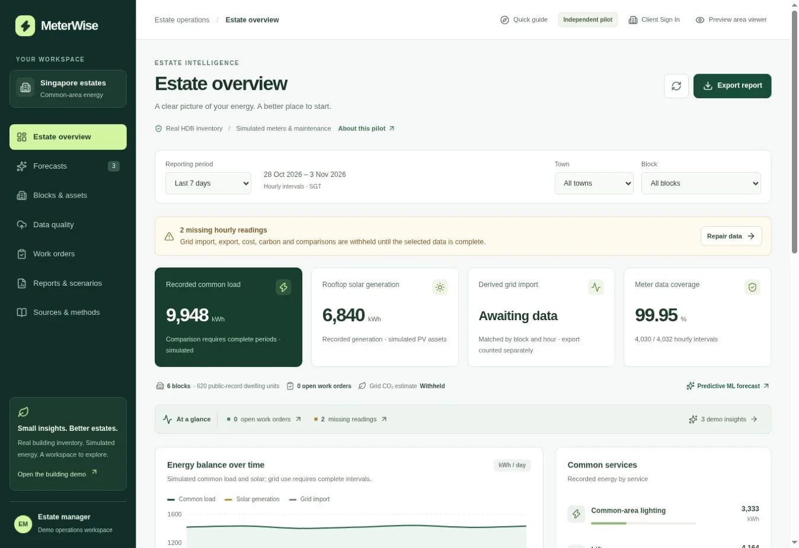

# MeterWise

An independent Singapore estate-energy operations pilot built with React and FastAPI. It combines public HDB building metadata with simulated energy and maintenance records.

**[Live demo](https://meterwise-kappa.vercel.app/)** · [Portfolio case study](https://teddy-qyuon-portfolio.vercel.app/projects/meterwise-building-energy-analytics)



## Scope and contribution

An AI-assisted personal project by Wai Yan Hpone Lat, covering the estate workspace, Python API, data-validation workflows and analytics presentation.

- Filter estate, block and reporting-period views.
- Inspect load, solar, grid imports and missing-data guidance.
- Preview CSV imports and track maintenance work-order changes.
- Compare clearly labelled example insights and export reports.

Operational readings, maintenance records and example scenarios are simulated. The hosted ML service remains unavailable; demonstration insights are labelled. The project is not affiliated with HDB, a Town Council or the Singapore Government, and makes no commercial or verified emissions-accounting claim.

## Stack

React, Vite, Tailwind CSS, Python 3.12, FastAPI, SQLite and Turso/libSQL. Vercel hosts the frontend and Python API. Node.js is used for frontend tooling.

## Run locally

Use Node.js 24 and Python 3.12. Create and activate a Python virtual environment, then:

```bash
git clone https://github.com/TeddyQyuon/meterwise.git
cd meterwise
python -m pip install -r requirements-dev.txt
npm ci
npm run dev
```

Vite serves `http://localhost:5173` and proxies `/api` to FastAPI on port 3001. SQLite persists locally in `data/`. Copy `.env.example` to `.env` for optional local settings. Production database credentials belong only in server environment settings.

## Checks

```bash
npm test
npm run build
npm run check:backend
```

`npm start` serves the built frontend through FastAPI. Backend tests cover workspace and role isolation, CSV bounds, energy balances and concurrent updates. Use synthetic data only.

## Sources and developer notes

- [HDB Property Information](https://data.gov.sg/datasets/d_17f5382f26140b1fdae0ba2ef6239d2f/view) supplies public building metadata.
- [Security notes](SECURITY.md) describe deployment safeguards.
- The original building demonstration remains available at `#overview`.
- Historical SQL migrations are retained in `drizzle/` for the Python backend.
